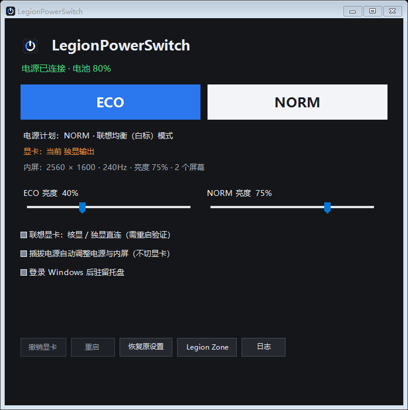

# LegionPowerSwitch

**优先面向国内 Y9000P 2025 及后续机型使用场景的 ECO / NORM 电源与显卡模式切换工具。** 自动识别内屏和联想扩展，不执行无法确认支持的硬件功能。

**v0.2.0-alpha.1 公开测试版，不是全机型已验证的正式版。**

## 优先适用场景 / Primary Audience

### 中文

**优先面向中国大陆销售的 2025 款及后续 Y9000P 用户：希望在外出核显省电与接电独显直连之间切换，又不想每次打开完整的 Legion Zone 控制中心，或进入 BIOS，再逐项调整 Windows 电源和内屏设置。** 本工具把支持的设置集中到 ECO / NORM 两个入口；显卡联动可选，所需重启仍由用户决定。

这是项目定位，**不是“2025 年以后的所有型号均已兼容”**。当前的实机验证基于 **Y9000P 2025 / IAX10H / 83F5 / NVIDIA GeForce RTX 5070 Ti Laptop GPU**。

| 设备范围 | 当前说明 |
| --- | --- |
| 上述 RTX 5070 Ti 开发机 | 已完成文末列出的本机测试，验证范围仍以该清单为准 |
| Y9000P 的 RTX 5060 / 5080 / 5090 等其他配置及后续款 | 适配候选，尚无本项目实机验证，不因系列名或显卡编号接近就承诺兼容 |
| Y7000 / Y7000P 系列 | 欢迎验证的候选系列，尚未实测，不列为已支持机型 |
| 旧款、锐龙 / R 系列、海外 Legion 机型 | 不预设“没有核显”或“必然兼容”，须核对具体 CPU、平台、BIOS 和接口 |

这里的痛点是**显卡切换入口与日常电源设置分散，反复操作麻烦**，并非已经证实 Legion Zone 在技术上独占所有机型的显卡切换。本程序使用现有联想固件 / WMI 接口，不破解 BIOS，也不保证卸载全部联想组件后仍可用。

### English

**Primarily for China-market Y9000P users, especially 2025 and later models, who want fewer steps between battery-saving integrated graphics and plugged-in discrete-direct use.** Instead of repeatedly opening the full Legion Zone utility or entering BIOS and then adjusting Windows settings separately, ECO / NORM groups supported changes into two actions. Graphics switching is optional; any required restart remains user-controlled.

The physically tested development machine is **Y9000P 2025 / IAX10H / 83F5 / RTX 5070 Ti Laptop GPU**. Other Y9000P GPU variants (including RTX 5060 / 5080 / 5090), later models, and Y7000 / Y7000P systems are **unverified candidates, not a supported-device guarantee**. Older, Ryzen-based, and international Legion systems also require device-specific validation.

The problem addressed is fragmented controls and repeated setup, not a proven technical monopoly by Legion Zone. The tool uses existing firmware / WMI interfaces; it does not unlock BIOS features or guarantee operation after removing every Lenovo component.

## 为什么做这个工具 / Why This Tool Exists

### 中文

最初的痛点很具体：游戏本平时插电、接外屏使用，拔电后掉电较快；临时要带出门，却得先在 Windows 设置和厂商控制软件之间来回找选项；回到工位，又要把这些设置逐项改回。LegionPowerSwitch 起源于这类反复发生、但不值得每次都花时间处理的麻烦。

- **省电设置太分散，临出门容易来不及调整。** 电源模式、CPU 策略、睿频、亮度、刷新率和睡眠时间分布在不同位置。ECO 把本机支持的调整集中到一个按钮，减少重复查找和遗漏。
- **回到工位，不代表要一直开最高性能。** NORM 面向接电后的日常均衡使用；兼容联想机型选择白标，而不是强制红标。需要打游戏或重负载时，仍可自行用 Fn+Q 或厂商软件切换。
- **不想为了方便，就被迫一直使用混合显卡模式。** 对于希望保留明确核显 / 独显直连选择的场景，显卡联动是可选项；兼容联想设备可以随模式请求切换，但仍需用户自行重启。它不是其他品牌 BIOS 显卡切换的通用替代品，也不承诺解决所有双屏兼容问题。
- **点了按钮，还要知道到底有没有生效。** 当前状态与待重启目标分开显示；未重启又切回原模式时，会尝试撤销待处理请求，避免把“已请求”误认为“已切换”。

目标是让“带走电脑”和“回到工位”少几步操作，而不是接管厂商热键、强制重启，或承诺未经测量的续航提升。

### English

The original problem was specific: a gaming laptop normally used on AC power with an external display drained its battery quickly when unplugged. Taking it out on short notice meant digging through Windows settings and the manufacturer's utility, then undoing those changes one by one when returning to the desk. LegionPowerSwitch grew out of that recurring friction.

- **Power-saving settings are scattered, and there may be no time to adjust them before leaving.** Power mode, CPU policy, boost, brightness, refresh rate, and sleep timers live in different places. ECO groups the adjustments supported by the device into one action.
- **Returning to the desk does not always mean needing maximum performance.** NORM targets balanced everyday use on AC power. On compatible Lenovo machines, it selects balanced mode rather than forcing performance mode. Fn+Q and the manufacturer's controls remain available for gaming or demanding work.
- **Convenience should not require staying in hybrid graphics mode.** Graphics switching is optional for users who prefer explicit integrated-only or discrete-direct modes. Compatible Lenovo devices can receive a mode-change request, but a user-initiated restart is still required. This is not a universal BIOS graphics switch for other brands or a fix for every multi-monitor issue.
- **A button press should not be mistaken for a completed change.** Current state and pending restart targets are shown separately. Switching back before restarting attempts to cancel the pending request.

The goal is fewer steps when leaving or returning, not taking over vendor hotkeys, forcing restarts, or promising unmeasured battery-life gains.



## 下载与使用

在 [Releases](https://github.com/voicelesskevin/LegionPowerSwitch/releases) 下载 Windows x64 ZIP，完整解压后双击 `Install.cmd`。

- 默认安装到 `D:\software\LegionPowerSwitch`；没有 D 盘或不可写时使用 `%LOCALAPPDATA%\Programs\LegionPowerSwitch`。
- 安装脚本创建桌面和开始菜单快捷方式；也可直接运行解压目录里的程序。
- 外出用 **ECO**，接电用 **NORM**。基础电源切换无需重启。
- Windows 10 / 11 **x64**，需要 .NET Framework 4.8；不支持 macOS、Linux、ARM64 原生运行。
- 程序需要管理员批准，当前未代码签名。遇到企业策略或安全软件拦截时交由管理员审核，不要关闭防护。
- 自选位置：`powershell.exe -NoProfile -File .\Install.ps1 -Destination "E:\Apps\LegionPowerSwitch"`。

## 模式

| 设置（仅在接口可用时） | ECO | NORM |
| --- | --- | --- |
| Windows 电源模式 | 最佳能效 | 接电均衡，电池保持能效 |
| 独立电源计划 | CPU 最大处理器状态 80%、关闭睿频；3 分钟熄屏 / 10 分钟睡眠 | 接电最大处理器状态 100%、启用睿频；15 分钟熄屏 / 30 分钟睡眠 |
| 内屏刷新率 | 优先 60Hz，否则可用的较低刷新率 | 恢复首次使用前的刷新率 |
| 内屏亮度 | 默认 40%，可调 | 默认 75%，可调 |
| 联想性能模式 | 安静 | 均衡白标，不自动选红标 |
| 联想显卡（可选，默认关闭） | 请求核显专用 | 请求独显直连 |

80% 是 Windows 的处理器状态策略，不保证实际频率、功耗或使用率变成 80%。不承诺具体续航小时数。
受限系统会尝试仅调整可用的 Windows 电源模式，报告跳过的项目。
不修改风扇曲线、超频、TDP、充电上限、分辨率或缩放。

## 兼容性与保护

- 基础功能不依赖 Legion Zone。非联想电脑使用可用的 Windows 功能，不写联想固件接口。
- 内屏按嵌入式连接类型和完整显示器实例识别，不根据主屏或固定面板型号猜测。
- 内屏识别不唯一时跳过屏幕控制；复制输出无法独立调整时跳过刷新率，不拿外接屏试写。
- 联想性能与显卡要求 WMI 方法、参数、支持标记及读回状态匹配；BIOS / 驱动变化仍可能影响兼容性。
- 显卡联动、插拔电源自动切换、登录启动均默认关闭。
- 显卡请求不等于生效，需保存工作后自行重启，再打开程序核对。不热重置显卡，不强制关闭程序或自动重启。
- 多屏时阻止 ECO 核显请求；未重启的 ECO / NORM 往返会尝试撤销待处理目标，失败保留状态。
- Fn+Q 仍能自由切换性能模式。状态轮询不会改回按钮模式；避免两套自动策略互相覆盖。

联想扩展依赖本机现有固件 / WMI 驱动，不保证卸载所有联想组件后仍可用。
其他品牌没有统一 BIOS 显卡切换接口，本版不替代它们的厂商显卡控制程序。

## 旧款、锐龙与海外机型 / Older, Ryzen and International Models

### 中文

- **“核显”和“集显”在这里通常指同一类处理器集成显卡（iGPU）**，不是两个需要互相切换的独立显卡类别；本项目讨论的是 iGPU 与独显（dGPU）的模式。
- **显卡模式切换并非从 2025 款才出现。** 联想的 [Y7000P / Y9000P 2022 官方说明](https://tools.lenovo.com.cn/doc/detail/id/2080/html) 已涉及 Legion Zone 独显直连与 BIOS 混合模式。这不能直接证明本工具兼容这些旧款。
- **锐龙 / R 系列要看具体 CPU 和整机设计。** 例如 [Ryzen 9 7945HX](https://www.amd.com/en/products/processors/laptop/ryzen/7000-series/amd-ryzen-9-7945hx.html) 带 Radeon 610M，而 AMD 说明 [Ryzen 7 7435HS 等型号没有集成显卡](https://www.amd.com/en/blogs/2024/new-amd-ryzen-notebook-dgpu-paired-offerings-.html)。这些是处理器差异的例子，不是本项目的已测配置清单；有 iGPU 也不等于显卡切换接口兼容。
- **海外版不是天然免去这些步骤。** 联想海外手册在 [较早的 Legion 机型中介绍 Lenovo Vantage](https://download.lenovo.com/manual/legion7_16_7/user_guide/en/explore_GPUMode.html)，在 [Gen 10 Legion Pro 7 系列中介绍 Legion Space](https://download.lenovo.com/pccbbs/pubs/legion_pro7_16_10/user_guide/en/index.html)。其中包含混合、仅核显相关模式与独显模式，新款手册也明确切到 DGPU Only 需要重启。应按具体机型手册判断，不能假定海外版不需要厂商工具或重启。

### English

- Here, iGPU means processor-integrated graphics; dGPU means discrete graphics.
- GPU-mode switching predates 2025: Lenovo documents it for the [2022 Y7000P / Y9000P](https://tools.lenovo.com.cn/doc/detail/id/2080/html). This does not establish compatibility with this tool.
- Ryzen models vary: the [7945HX includes Radeon 610M](https://www.amd.com/en/products/processors/laptop/ryzen/7000-series/amd-ryzen-9-7945hx.html), whereas [7435HS-class examples lack integrated graphics](https://www.amd.com/en/blogs/2024/new-amd-ryzen-notebook-dgpu-paired-offerings-.html). These examples are not a tested-device list; an iGPU alone does not establish firmware-interface compatibility.
- International Lenovo guides describe GPU-mode controls in [Vantage on an earlier model](https://download.lenovo.com/manual/legion7_16_7/user_guide/en/explore_GPUMode.html) and [Legion Space on Gen 10 Pro 7](https://download.lenovo.com/pccbbs/pubs/legion_pro7_16_10/user_guide/en/index.html). A restart is required for DGPU Only in the latter guide. Overseas models are not automatically free of vendor-utility or restart requirements.

## 恢复、更新、移除

首次应用前在安装目录生成本机 `original.json`，并尝试导出 `original-power-plan.pow`。恢复备份及显卡待处理记录绑定本机。

- 恢复：点击“恢复原设置”，恢复已记录的电源、联想模式、亮度和刷新率；不自动改回已经重启生效的显卡模式。
- 更新：从托盘退出旧程序，运行新包安装脚本。程序文件会备份，当前设置和恢复备份不被覆盖。
- 移除：先恢复、取消登录启动、从托盘退出，再删除安装目录及快捷方式。新建的电源计划不自动删除。
- 旧个人版：缺少设备绑定的旧备份需要在原电脑核验迁移；不要复制其他电脑的数据。

数据和日志只保存在本地，无遥测、无联网更新、无账号登录。安装目录需可写，启用登录任务后不要移动目录。
不要把使用后的整个安装目录分享；干净下载包不应包含设置、日志、设备报告或电源备份。

## 已测范围

2026-10-18：

- 18 项显卡请求 / 撤销 / 重启后验证模拟测试。
- 32 项兼容策略测试：非联想、缺失接口、未知状态、内外屏识别、模糊面板、刷新率、跨设备备份、默认开关。
- 100% / 150% / 200% 界面缩放、长结果换行、禁用按钮可读性。
- **Y9000P 2025 / IAX10H / 83F5 / RTX 5070 Ti Laptop GPU** 实测 ECO、NORM 和恢复，电源、亮度、刷新率、联想模式读回通过。
- 在同一台机器上禁用联想扩展，通用降级路径实测通过；不等于其他品牌机器已实测。
- 旧个人版收到过用户实际重启切换显卡成功的反馈；当前通用版未再次重启验证显卡切换。

其他机型、BIOS、外接屏组合、Modern Standby 受限策略仍需对应设备验证，不能据此宣称全机型兼容。

## 构建与测试

使用系统 .NET Framework C# 编译器，无需 NuGet：

```powershell
.\Build.ps1
.\Test.ps1
powershell.exe -NoProfile -File .\TestAppearance.ps1
.\Package.ps1
```

单元测试不访问硬件，界面测试用模拟能力。`TestRuntime.ps1` 则真实调整电源、亮度、刷新率和联想模式后尝试恢复，不请求切显卡、不重启。只应在接电、保存工作、退出其他控制器后由管理员手动运行。

反馈请提供 Windows、机型、BIOS、失败功能与脱敏日志。**不要公开完整诊断文件、设备标识、用户名或电源备份。**

## License / Credits

GPL-3.0-only，见 [LICENSE](LICENSE) 与 [THIRD-PARTY-NOTICES.md](THIRD-PARTY-NOTICES.md)。
非官方项目，与 Lenovo / Microsoft 无隶属或认证关系，商标归原权利人所有。

English: Windows x64 ECO / NORM switch focused on China-market Y9000P workflows, with capability-gated Lenovo extensions. Physically tested on one Lenovo 83F5 / RTX 5070 Ti laptop only; other GPU variants and Y7000-series models remain unverified.
